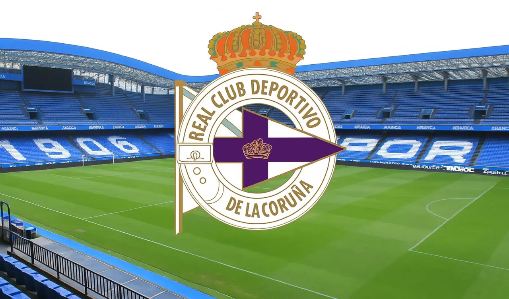

# Práctica libre 1.1 · RC Deportivo (con imagen)

## 📌 Sobre esta práctica

Segunda práctica de elementos básicos, sobre algo que me gusta: el **RC Deportivo**. Repite lo de la [práctica 1](../1%20Practica%20de%20elemetos%20Basicos) y añade lo que le faltaba: un **subtítulo `h2`**, **énfasis con `em`** y una **imagen** (`img`) con su texto alternativo, sus medidas y su propia carpeta.

## 🧩 Qué incluye

| Elemento | Uso en la página |
| :--- | :--- |
| `<html lang="es">` | Documento en español |
| `<title>` | Título de la pestaña: "Fútbol" |
| `<h1>` | Título principal: "RC Deportivo" |
| `` | Escudo del equipo, con `src`, `width`, `height` y `alt` |
| `<p>` | Los párrafos del texto |
| `<b>` | Resalta la palabra *Primera* (sin darle importancia) |
| `<em>` | Énfasis en las emociones de los años malos y en *la liga va a ser muy difícil* |
| `<strong>` | Importancia en la frase final |
| `<pre>` | Mis expectativas para la temporada, respetando los saltos de línea |
| `<h2>` | Subtítulo: "La liga" |

### 🖼️ La imagen

```html

```

| Atributo | Para qué sirve |
| :--- | :--- |
| `src` | Ruta de la imagen. Es **relativa**: busca dentro de la carpeta `img/` |
| `width` / `height` | Tamaño en píxeles. Evita que la página "salte" al cargar la imagen |
| `alt` | Texto que **describe** la imagen. Se lee si no carga y lo usan los lectores de pantalla |

### 📂 Estructura de la carpeta

```
1.1 Practica de Elementos basicos con IMG/
├── index.html
├── Readme.md
└── img/
    └── Depor.webp
```

Las imágenes van en una subcarpeta `img/` para no mezclarlas con el código.

## 💻 Cómo verla

Abrir `index.html` con doble clic o con **Live Server** en VS Code. La carpeta `img/` tiene que estar junto al `index.html`, si no, la imagen no se ve.

## 📝 Notas

✅ **Se ve correctamente en el navegador.** Errores que tenía y corregí:

- **El archivo se llamaba `idex.html`.** Debe ser `index.html`: los servidores y GitHub Pages lo buscan como página de inicio.
- **`alt="40"`:** el `alt` debe describir la imagen, no ser un número.
- **`lang="en"`** con el texto en español: cambiado a `lang="es"`.
- **Un `<br>` partía una frase por la mitad.** `<br>` es para saltos dentro de un texto; para separar ideas se usan párrafos.
- **`<strong>` solo para lo importante:** para emociones o énfasis, `<em>`.
- **Imagen junto al título,** no en medio del texto.
- **Muchas erratas** (*ahoa, ilusion, estres, volve, cotra, barsa...*): hay que pasar un corrector antes del commit.

**Pendiente para más adelante:** envolver la página en `header`, `main` y `section` cuando practique los elementos semánticos.